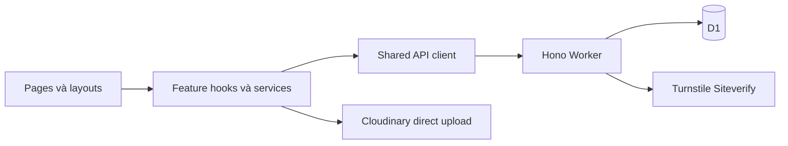

# Kiến trúc Lunarra

Explanation dành cho developer và maintainer: ranh giới module, ownership, các luồng liên kết và lý do thiết kế. Đối chiếu source **19/10/2026**; trạng thái nghiệm thu/deployment thuộc [PROJECT_STATUS](PROJECT_STATUS.md). [API contract](reference/API_CONTRACT.md), [schema](reference/DATABASE_DESIGN.md) và [model frontend](reference/FRONTEND_ENTITIES.md) sở hữu chi tiết tương ứng.

## Ranh giới module

- `app` ghép router/providers/layouts; `pages` chỉ ghép feature hooks/views. Menu, location và logout của layout ở `app/layouts/hooks/`.
- Feature sở hữu state, actions, services, types và fixtures trong `src/features/`. Component trình bày nhận props; view → hook → feature service → shared API client. Cross-feature import đi qua `index.ts`, không truy cập nội bộ feature khác.
- `src/shared/` chứa primitive, presentation helpers, API client, i18n, theme và flags; không sở hữu nghiệp vụ catalog/cart/order/auth. Root `shared/` riêng giữ constants/Zod schemas dùng chung frontend và Worker.
- Tailwind xử lý trình bày thông thường; CSS giữ tokens/theme/focus toàn cục. Alias `@/` trỏ `src/`; giữ resolver `figma:asset/`. Props cấu hình Recharts như `contentStyle`/`tick` là API component, không phải page stylesheet. Stack/build và quyết định dependency ở [TECH_STACK](TECH_STACK.md).

## Router và provider ownership

[router.tsx](../src/app/router.tsx) là nguồn route duy nhất; basename lấy từ Vite `BASE_URL`. `MetadataLayout` bọc routes. `MainLayout` dùng chung storefront; `AuthLayout` tách admin login; `AdminRoute` bọc `AdminLayout`, các page admin được lazy-load. `/admin` chuyển dashboard, `/admin/products` chuyển stock; route chưa có API dùng UnavailablePage.

[AppProviders](../src/app/providers.tsx) ghép theo thứ tự **I18nextProvider → AuthProvider → CatalogProvider → WishlistProvider → CartProvider**. `CheckoutLayout` đặt CheckoutFlowProvider quanh riêng `/cart` và `/checkout`; vì vậy draft giữ khi đi giữa hai trang nhưng mất khi rời nhóm hoặc reload. Catalog/cart/wishlist ngoài nhóm không bị dựng lại chỉ vì chuyển giữa hai trang.

| Nhóm luồng | Nơi đọc chi tiết |
| --- | --- |
| Home, Shop, detail và yêu thích storefront | Các mục dưới; state/storage ở [FRONTEND_ENTITIES](reference/FRONTEND_ENTITIES.md) |
| Giỏ → form → review → API confirmation | [CHECKOUT_UI](features/CHECKOUT_UI.md) |
| Tra đơn bằng mã và SĐT | [ORDER_TRACKING](features/ORDER_TRACKING.md); dùng public projection, không polling |
| Admin summary/orders/products/stock/delivery | [API contract](reference/API_CONTRACT.md#admin-cookie-lunara_admin-httponly); source ở `features/admin` |
| Customer auth/profile/history/wishlist tài khoản/request | Source deferred; [BACKLOG](pipeline/BACKLOG.md) và cờ tính năng dưới đây |

## Catalog và cuộn trang

- CatalogProvider tải categories/products qua Shop service cùng origin, không fallback fixture. Featured lấy `is_featured` từ DB; Home hiển thị tối đa bốn sản phẩm. Thứ tự Home là Hero → dải dịch vụ COD → FeaturedCollection → Journey → OurStory. Dãy ảnh danh mục Home đã bỏ; navigation/Shop vẫn có danh mục.
- Shop lọc/tìm/sort ở frontend trên catalog API có giới hạn MVP, không phải tìm kiếm toàn bộ database không giới hạn. Category và `q` ở URL; sort và khoảng giá là state local. Khoảng giá VND: [0,500k), [500k,1m), [1m,2m), [2m,+∞).
- Shop dùng `smallestVariant` để hiển thị/lọc/sort/quick-add; size nhỏ nhất hết hàng thì khóa Add, không tự chuyển size lớn. Home không truyền lựa chọn size nên ProductCard chọn variant còn hàng đầu tiên; chọn size khác ở detail. Giá card có thể khác `Product.price` thấp nhất của adapter; không sửa DTO chỉ để ép hai giá giống nhau.
- `useRouteScroll` đưa điều hướng/search từ Header và Back/Forward về đầu; hash giữ đích có trừ sticky header. Shop dùng URL REPLACE + `state.preserveScroll` để đổi bộ lọc tại chỗ; POP về URL đã lọc vẫn về đầu. Tắt native scroll restoration và chạy thêm một frame vì menu portal có thể trả focus sau commit. Đổi locale/theme hoặc mở dialog không tự reset route.

Nguồn: [useProducts](../src/features/shop/hooks/useProducts.ts), [shop.service](../src/features/shop/shop.service.ts), [ProductCard](../src/features/shop/components/ProductCard.tsx), [useRouteScroll](../src/app/layouts/hooks/useRouteScroll.ts).

## Chi tiết sản phẩm và hoa yêu thích

- Detail tải theo slug, có loading/retry/404, gallery/zoom, size hiện giá và quantity. Lượng thêm tối đa theo `max_quantity` trừ lượng variant đã trong giỏ. Thêm vào giỏ giữ trang; Mua ngay chỉ chuyển `/cart` sau khi thêm thành công, không gửi đơn.
- Gợi ý tối đa bốn mẫu khác, ưu tiên cùng danh mục; giá/variant dùng quy tắc size nhỏ nhất, Xem thêm tới Shop. Mô tả vẫn từ DB. Các phần Câu chuyện/Ý nghĩa/Chi tiết & Chăm sóc đang hiển thị nội dung cập nhật sau theo owner; chưa có field/API/admin riêng để nhập chúng.
- WishlistProvider giữ Product snapshots trong memory qua route, dùng chung card/detail/header; không tài khoản/API/storage. Sidebar chỉ hiện từ 768 px; reload mất, resize xuống mobile đóng panel. Toggle trái tim không tự mở panel; Escape/đóng trả focus, không đổi route. Đây là wishlist storefront, khác source wishlist tài khoản còn ẩn.

Nguồn: [useProductDetail](../src/features/shop/hooks/useProductDetail.ts), [WishlistProvider](../src/features/shop/WishlistProvider.tsx), [WishlistDrawer](../src/features/shop/components/WishlistDrawer.tsx). Layout/ảnh/interaction chung thuộc [design system](ui-ux/DESIGN_SYSTEM.md).

## Worker và dữ liệu bền vững

Hono Worker phục vụ `/api/*` cùng origin với assets; D1 là nguồn giá, tồn, phí và snapshot đơn. Health chỉ kiểm Worker liveness, không kiểm database readiness. Catalog dùng truy vấn theo lô thay cho N+1; quote chỉ đọc và không giữ tồn. Coverage phải khớp danh mục hành chính và zone active của phường, không fallback tỉnh; [DELIVERY_ADDRESS](features/DELIVERY_ADDRESS.md) sở hữu quy tắc này.

Tạo đơn dùng server pricing và UUID v4 idempotency. Trong một batch, INSERT order/items/history đi cùng trừ tồn không điều kiện; `CHECK (stock_quantity >= 0)` gây rollback nếu bán quá tồn. **UPDATE ảnh hưởng 0 dòng không phải lỗi**, nên điều kiện `WHERE stock >= quantity` tự nó không bảo vệ tính nguyên tử của đơn.

Với N dòng, createOrder đọc replay/pricing rồi gửi batch `2N + 2`: N=15 dùng 35 statements; diagnostic read có thể thành 36. Guard giữ mọi failed batch/retry trong budget ≤40 và dành một statement chẩn đoán; không coi retry là miễn phí. `transitionOrder` dùng điều kiện trạng thái/CAS, hoàn tồn trước đổi trạng thái trong cùng giao dịch và kiểm `meta.changes`; hủy lặp không hoàn hai lần. DELIVERED xác nhận COD PAID. Contract replay, trạng thái và giới hạn chính xác ở [API_CONTRACT](reference/API_CONTRACT.md); ràng buộc lưu trữ ở [DATABASE_DESIGN](reference/DATABASE_DESIGN.md).

Lookup chỉ dùng public projection, không trả admin_note/stock_released/actor; admin có projection riêng. Variant bị xóa giữa pricing và batch làm FK của item thất bại, rollback đơn; khi hoàn tồn bỏ qua variant_id=NULL vì snapshot đơn vẫn còn. History transition dùng NOT EXISTS, mọi write cùng điều kiện trạng thái đã đọc.

Collision mã đơn chỉ retry khi còn đủ budget cho cả batch và một diagnostic read, tối đa ba batch. Với giỏ 15 dòng, failed batch đầu đã dùng 35 statements nên không retry nguyên batch; CHECK thiếu tồn chỉ đọc chẩn đoán rồi trả lỗi, không tự mua lại. Contract HTTP/UUID/replay và mã đơn thuộc [API](reference/API_CONTRACT.md#post-apiorders); cap PENDING/expiry thuộc Bot.

## Quyền, phiên và ranh giới provider

- MVP chọn một mật khẩu admin ngẫu nhiên trong server secret, SHA-256/timingSafeEqual và JWT HS256 cookie; tránh băm chậm trong thiết kế có sizing CPU thấp. Đây không phải đo cloud CPU hoặc mô hình nhiều tài khoản; mở rộng auth cần quyết định riêng. Contract độ dài/cookie/expiry ở [API](reference/API_CONTRACT.md#admin-cookie-lunara_admin-httponly), rotate/revoke ở Operations.
- AdminRoute chỉ bảo vệ điều hướng UI. Worker `requireAdmin` kiểm mỗi admin path, trừ đúng POST login; writes còn kiểm Origin/JSON. AuthProvider đọc `/me`, login/logout bằng cookie, bỏ response session lỗi thời và xóa state khi 401. Không dùng role client hoặc sessionStorage làm authorization.
- Inventory delta không có idempotency như tạo đơn. Khi phản hồi ghi mơ hồ, UI xóa delta/khóa row tới GET kiểm lại thành công; người vận hành đối chiếu trước lần ghi mới. Không retry/cộng bù đoán. [OPERATIONS](operations/OPERATIONS.md#7-khu-vực-giao-và-tồn-kho) giữ thao tác an toàn.
- Turnstile/rate limit/cap PENDING/TTL/restock thuộc [BOT_PROTECTION](operations/BOT_PROTECTION.md); headers/CSP/SEO/redacted diagnostics thuộc [HARDENING](operations/HARDENING.md). Kiểm local không chứng minh CPU cloud hay provider thật.
- Cloudinary upload đi browser → provider theo params Worker ký; chỉ Save product mới ghi URL/public ID vào D1. Không auto-retry upload hay tự xóa asset; [CLOUDINARY](operations/CLOUDINARY.md) sở hữu lifecycle, API contract sở hữu DTO/validation.

## Feature deferred và quyết định còn thiếu

`VITE_ENABLE_CUSTOMER_AUTH` chỉ là yêu cầu opt-in; `customerApiReady=false` vẫn chặn kích hoạt fixture. Custom requests, admin customers/settings/notifications cũng chưa bật theo [features.ts](../src/shared/config/features.ts). Các source legacy PHP/settings/demo được giữ để phát triển sau, không dùng xác nhận thao tác thật.

UI active dùng số nguyên VND và ngày giao Asia/Ho_Chi_Minh; EN/VI không đổi currency/timezone hoặc dịch dữ liệu khách. Policy phí/cutoff/slots, dữ liệu mở bán và nội dung kinh doanh còn cần owner chốt tại [PROJECT_STATUS](PROJECT_STATUS.md#việc-còn-cần-chủ-shop). Không xóa quyết định sản phẩm chưa triển khai chỉ vì source chưa có; roadmap thuộc [BACKLOG](pipeline/BACKLOG.md).
