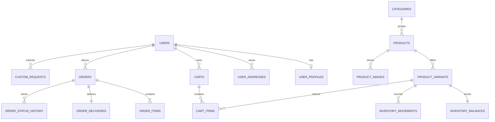

# Đề xuất database cho Lunara

Đây là thiết kế đề xuất từ [entity FE đã khảo sát](FRONTEND_ENTITIES.md). Chưa chọn hệ quản trị DB hoặc viết migration/backend. Tên bảng dùng số nhiều, snake_case; ID là UUID hoặc BIGINT do backend quyết định. Tiền vẫn PHP; ngôn ngữ Việt không tự đổi sang VND.

## Các thay đổi mình sẽ chọn

- **Gộp:** account/profile/customer về một identity; orders/request của khách và admin dùng cùng entity.
- **Tách:** product/variant/ảnh/category; order/order item/delivery/status history; inventory balance/movement; payment method/payment status.
- **Thêm:** ID/FK ổn định, SKU, timestamp, contact/address snapshots, status codes, inventory movements, uniqueness và server-side validation.
- **Bỏ khỏi dữ liệu ghi chính:** total spent/order count/chart totals/rating average/tracking index; tính từ record thật. Không lưu token màu/icon hoặc bản dịch UI thành table nghiệp vụ.
- **Ngừng hard-delete:** sản phẩm có lịch sử đơn nên archive. Xóa wishlist/cart item có thể thực hiện bình thường; order/payment giữ lịch sử theo chính sách dữ liệu đã chốt.

## Bảng nên làm trước

| Bảng | Field quan trọng | Quan hệ / constraint |
| --- | --- | --- |
| `users` | id, email, password_hash hoặc auth_provider_subject, role, status, created_at, updated_at | Email chuẩn hóa unique; role user/admin; API không trả password_hash |
| `user_profiles` | user_id, first_name, last_name, phone, bio, avatar_url, preferred_locale, is_vip | PK/FK user; preferred_locale en/vi; VIP do admin quản lý; không lặp email |
| `user_addresses` | id, user_id, recipient_name, phone, address_line, city, region, postal_code, country_code, is_default | FK user; địa chỉ nhận hàng có thể khác profile |
| `categories` | id, code, name_en, name_vi, sort_order, is_active | code unique; không có record `All` |
| `products` | id, category_id, slug, name_en, name_vi, description_en, description_vi, badge_code nullable, is_featured, status, created_at, updated_at, archived_at | slug unique; category FK; badge/featured cho collection hiện có; không cần hai cột name_vi/name_vn |
| `product_variants` | id, product_id, sku, size_code, price, currency, is_active | SKU unique; unique product+size; price >= 0 |
| `product_images` | id, product_id, url, alt_en, alt_vi, sort_order, is_primary | FK product; dùng storage URL, không đưa binary ảnh vào product row |
| `inventory_balances` | variant_id, on_hand, reserved, reorder_threshold, updated_at | PK/FK variant; số lượng >= 0; available = on_hand - reserved |
| `inventory_movements` | id, variant_id, quantity_delta, reason, order_id nullable, actor_id nullable, created_at, note | Ledger cho restock/sale/cancel/adjust; balance cập nhật cùng transaction |
| `carts` | id, user_id nullable, guest_token_hash nullable, expires_at, created_at, updated_at | Có chủ sở hữu user hoặc guest; guest token không lưu dạng có thể dùng trực tiếp |
| `cart_items` | id, cart_id, variant_id, quantity, created_at, updated_at | unique cart+variant; quantity > 0; cart price là quote, server lấy giá catalog khi checkout |
| `orders` | id, order_number, user_id nullable, status_code, currency, subtotal, discount_total, delivery_fee, grand_total, placed_at, updated_at | order_number unique; totals do server tính; user nullable cho guest nếu hỗ trợ |
| `order_items` | id, order_id, product_id nullable, variant_id nullable, sku_snapshot, name_en_snapshot, name_vi_snapshot, size_snapshot, unit_price, quantity, line_total | FK order; giữ snapshot kể cả product archive; quantity > 0 |
| `order_deliveries` | order_id, recipient_name, email, phone, address_line, city, region, postal_code, country_code, method_code, requested_date, notes, tracking_number | PK/FK order cho một lần giao; đây là snapshot, không chỉ trỏ user_addresses |
| `order_status_history` | id, order_id, from_status, to_status, actor_id nullable, occurred_at, note | Timeline; index order_id+occurred_at; transition do server kiểm tra |
| `custom_requests` | id, reference, user_id nullable, contact_name, email, phone, recipient_name, occasion_code, size_code, color_codes, flower_codes, budget_amount nullable, currency, needed_date, message, status_code, assigned_to nullable, created_at, updated_at, order_id nullable | contact snapshot; reference unique; colors/flowers là JSON arrays code đã validate hoặc join tables; có thể thành order khi được chấp nhận |
| `wishlist_items` | user_id, product_id, created_at | PK/unique user+product; bỏ hai wishlist demo độc lập |
| `store_settings` | id, name, email, phone, address, currency, timezone, updated_at | Một cửa hàng ở phạm vi hiện tại; chưa tự mở rộng multi-store |
| `notification_preferences` | user_id, new_order, low_stock, new_request, email_digest, updated_at | PK/FK user; settings theo nhân viên, không dùng một bộ global |

19 bảng này là phạm vi nền đầy đủ cho những flow FE đang có. Có thể làm theo ba đợt: identity/catalog/inventory, rồi cart/orders/delivery, sau đó custom request/wishlist/settings. Payment thật cần các bảng bên dưới trước khi đưa checkout vào production.

## Bảng bổ sung theo tính năng sử dụng

| Bảng | Khi cần / field đề xuất |
| --- | --- |
| `delivery_methods` | Quản trị method/fee: code, label_en/vi, base_fee, currency, is_active. Cutoff và khu vực cần quyết định riêng |
| `coupons`, `coupon_redemptions` | Coupon code unique; discount_type/value, minimum_subtotal, starts_at/ends_at, usage_limit, per_user_limit; redemption FK order/user và amount snapshot |
| `payments`, `payment_events` | Khi thu tiền: order_id, provider, method_code, provider_reference unique, amount, currency, status_code; webhook/event ID unique để xử lý idempotent. Không lưu dữ liệu thẻ/CVV |
| `suppliers`, `product_suppliers` | Supplier/contact và quan hệ nhiều sản phẩm; nếu hoa nguyên liệu có nhiều nguồn, liên kết nguyên liệu thay product bán lẻ |
| `occasions`, `color_palettes`, `flower_types`, `arrangement_sizes` | Lookup của wizard: code unique, label_en/vi, description_en/vi nếu có, is_active, sort_order; palette có swatches |
| `custom_request_colors`, `custom_request_flowers` | Join request với option ID khi cần filter/report/admin config. Với MVP có thể dùng JSON arrays code đã validate, không lưu chuỗi nối dấu phẩy |
| `reviews` | user_id, product_id, order_item_id nullable, rating 1–5, comment, moderation_status, created_at; average/count tính từ review được duyệt |
| `testimonials` hoặc `content_blocks` | Quản trị copy landing/collection đa ngôn ngữ; không trộn testimonial tuyển chọn với mọi customer review |
| `admin_audit_logs` | Theo dõi ai sửa giá/tồn/status/settings, entity_id, action, before/after đã loại thông tin nhạy cảm, occurred_at |
| `materials`, `product_recipe_items`, `material_stock_batches` | Nếu quản lý hoa nguyên liệu: vật tư/SKU, định mức nguyên liệu cho variant, lô nhập/ngày nhận/ngày hết hạn. Lookup flower_types của wizard không thay inventory nguyên liệu |

Chưa cần bảng dashboard KPI, chart/month/filter tab, cart count, UI colors, language button, password-strength score hoặc sessionStorage user. Chưa cần bảng `translations` để dịch text UI: JSON `react-i18next` hiện đủ. Nếu bổ sung nhiều ngôn ngữ sau này, có thể thay name_en/name_vi bằng `product_translations(product_id, locale, name, description)`; với hai ngôn ngữ, cột riêng dễ vận hành.

## Tên đa ngôn ngữ và hợp đồng API

Sơ đồ quan hệ lõi (các bảng option/payment/settings ở trên được bổ sung theo flow):



`vi` là code tiếng Việt trong frontend. `name_vn` được hỗ trợ như alias đầu vào; đừng tạo hai cột tiếng Việt để rồi lệch dữ liệu.

```json
{
  "id": 1,
  "name_en": "Blush Peony Bouquet",
  "name_vi": "Bó mẫu đơn hồng phấn",
  "price": 1200,
  "currency": "PHP",
  "category_code": "bouquets"
}
```

Đây là **ví dụ contract**, chưa phải API đã kết nối. Adapter `normalizeProduct` nhận các field tên của DTO và tạo `name` compatibility cho FE hiện tại. Tiếng Việt ưu tiên name_vi → name_vn → name_en → name; English ưu tiên name_en → name → name_vi → name_vn. Field trống được bỏ qua. Tên hiện tại luôn giữ trong catalog; search chấp nhận cả Việt/English và không phân biệt dấu. ID/variant và quantity không phụ thuộc locale.

FE hiện vẫn dùng numeric `price` và English category label; khi nối API dùng adapter map category_code thành domain code đã thống nhất, parse money có kiểm tra, và giữ tên snapshot trong order_items. Không đổi toàn bộ state sang label Việt. `name_vn` không phải tên tiếng Anh; field Anh chuẩn là `name_en`.

## Tiền, thời gian, trạng thái và tính nhất quán

- Tiền DB: `DECIMAL/NUMERIC(12,2)` + currency, hoặc integer minor units + currency. Chọn **một** convention cho API; nếu dùng minor units, ₱1,200 = 120000, không phải 1200. Float FE chỉ phục vụ hiển thị; backend tính giá/coupon/fee và làm tròn theo policy.
- Date/time: created_at/updated_at/placed_at dùng timestamp có timezone; needed_date là date tại múi giờ cửa hàng. Giữ Asia/Manila cho demo. Chuỗi `Jan 2025` là display, không phải storage format.
- Order codes đề xuất: pending, processing, in_transit, delivered, cancelled. Payment codes độc lập: pending, paid, failed, refunded; COD là method, không phải paid status.
- Request codes: pending, in_review, approved, completed, declined. Nếu thêm cancelled/expired cần xác định transition và UI.
- Stock: kiểm tra/reserve số lượng nguyên tử trong transaction, cập nhật ledger và balance cùng lúc; không để hai checkout cùng bán lượng tồn cuối. Reservation cần timeout/release khi hủy/hết hạn.
- Order không lấy lại unit_price từ product mỗi lần hiển thị. Không sửa đơn Delivered thành trạng thái bất kỳ chỉ vì client gửi label khác.
- Index thiết thực: orders(user_id, placed_at), orders(status_code, placed_at), order_items(order_id), custom_requests(status_code, needed_date), inventory_movements(variant_id, created_at), và các FK thường join. Search Unicode cần kiểm tra theo DB/collation đã chọn; FE normalizeSearch không thay index server.

Nếu chọn PostgreSQL, tham khảo [constraints/FK](https://www.postgresql.org/docs/current/ddl-constraints.html), [numeric types](https://www.postgresql.org/docs/current/datatype-numeric.html) và [transaction locks](https://www.postgresql.org/docs/current/explicit-locking.html). Các nguồn này hỗ trợ cơ chế DB; cách chia bảng ở trên là đề xuất từ flow Lunara, chưa phải migration đã chạy.

## Thứ tự nối FE với backend

1. Cấp ID identity chung; thay fixture auth/profile/customer bằng session API và server authorization.
2. Catalog API trả tên song ngữ/variant/ảnh; inventory dùng đúng variant ID.
3. Cart quote → server checkout transaction → order/payment/delivery snapshot → status history. Chỉ hiện thành công khi server xác nhận.
4. Request wizard và AdminRequests dùng cùng API; wishlist/profile/order history dùng cùng user ID.
5. Settings/notifications có quyền ghi phù hợp; dashboard query dữ liệu thật. Bỏ các aggregate fixture và success giả tương ứng khi thay API.
